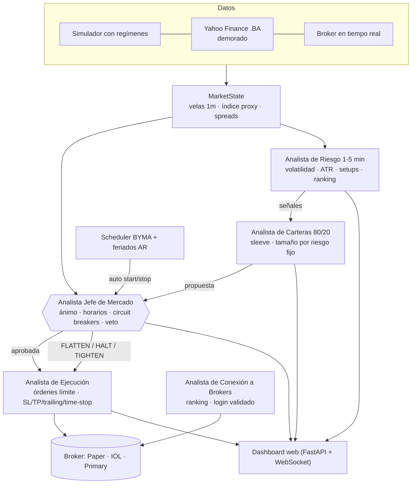

# Investments · Sistema multi-agente de trading intradiario (BYMA)

Agente supervisor + 4 subagentes especializados que analizan, validan y ejecutan operaciones de corto plazo
en el mercado argentino, con **prioridad absoluta en preservar el capital**. Incluye un dashboard web en vivo
con P&L, inversiones activas y niveles de riesgo, encendido/apagado automático según el horario de BYMA y
controles manuales (pausa, detener, **kill switch**).

> ⚠️ **Software educativo. No es asesoramiento financiero.** Arranca en modo **PAPER** (simulado). Operar con
> dinero real requiere habilitación explícita en `.env` **y** una frase de confirmación en la UI.

---

## Arquitectura



| Agente | Archivo | Skill |
|--------|---------|-------|
| **Analista Jefe de Mercado** (supervisor) | [`app/agents/chief.py`](app/agents/chief.py) | [`chief-market-analyst`](.agents/skills/chief-market-analyst/SKILL.md) |
| Analista de Conexión a Mercados/Brokers | [`app/agents/broker_connection.py`](app/agents/broker_connection.py) | [`broker-connection-analyst`](.agents/skills/broker-connection-analyst/SKILL.md) |
| Analista de Riesgo (1-5 min) | [`app/agents/risk_analyst.py`](app/agents/risk_analyst.py) | [`short-term-risk-analyst`](.agents/skills/short-term-risk-analyst/SKILL.md) |
| Analista de Múltiples Carteras (80/20) | [`app/agents/portfolio_manager.py`](app/agents/portfolio_manager.py) | [`multi-portfolio-manager`](.agents/skills/multi-portfolio-manager/SKILL.md) |
| Analista de Ejecución | [`app/agents/execution.py`](app/agents/execution.py) | [`execution-analyst`](.agents/skills/execution-analyst/SKILL.md) |

Los agentes son **deterministas y cuantitativos** (rápidos, auditables y reproducibles: requisito para una
ventana de 1-5 min). Las *skills* en `.agents/skills/` documentan el conocimiento experto de cada rol y sirven
para que un agente LLM (Antigravity, Claude Code, etc.) pueda razonar, auditar y extender el sistema.

## Controles de riesgo del Analista Jefe

- Stop loss (1.5×ATR), take profit (2R), break-even al +1R, trailing stop, salida por tiempo (5 min).
- Pérdida diaria máx. **-1.5%** y drawdown intradiario **3%** → cierra todo y frena el día.
- **Profit lock** al +3% diario. Enfriamiento tras 3 pérdidas seguidas y por activo tras cada pérdida.
- Sin entradas los **primeros/últimos 30 min** de rueda; cierre total 10 min antes del cierre; feriados AR.
- Lectura del **ánimo del mercado**: régimen (CALM / TRENDING / VOLATILE / CHAOTIC / UNCERTAIN), amplitud,
  z-score del índice, expansión de volatilidad y ensanche de spreads. Ante cambios difíciles de diagnosticar → frena.
- Anti-persecución de la puja: no compra > 2.5 ATR sobre VWAP ni tras velas-spike; órdenes límite con slippage máx.
- Rechaza operaciones cuyo objetivo no cubra **2× los costos** (comisión + IVA + derechos).

Todos los parámetros están en [`config/settings.yaml`](config/settings.yaml).

## Instalación y uso

```powershell
git clone https://github.com/Marius-1988/investments
cd investments
python -m venv .venv
.\.venv\Scripts\activate            # Linux/Mac: source .venv/bin/activate
pip install -r requirements.txt
pip install -r requirements-brokers.txt   # opcional: yfinance + pyRofex
copy .env.example .env               # Linux/Mac: cp .env.example .env

python -m app.main                   # abrir http://127.0.0.1:8000
```

- En horario de mercado el agente **se enciende solo** (`auto_start: true`) y se apaga al cierre.
- El simulador puede usarse fuera de horario (`ignore_schedule_in_simulation: true`): botón **▶ Iniciar**.
- **⏸ Pausar**: no abre nuevas posiciones pero sigue gestionando las abiertas.
- **■ Detener**: cierra posiciones y apaga (no se re-enciende automáticamente ese día).
- **⛔ KILL SWITCH**: cierre de emergencia de todo y bloqueo hasta el día siguiente.
- **🔌 Broker**: ranking de brokers del Analista de Conexión y asistente de login validado.

### Tests y backtest

```powershell
pytest -q
python -m scripts.simulate --minutes 360 --runs 8
```

## Conexión a brokers

| Broker | Estado | Notas |
|--------|--------|-------|
| Paper (interno) | ✅ | Default. Ejecuta contra puntas con costos reales |
| Primary API / Matba Rofex (pyRofex) | ✅ | **Recomendado.** Demo gratis en reMarkets; real vía ALyC |
| InvertirOnline (API REST) | ✅ | Validar endpoints con la doc vigente antes de operar en vivo |
| PPI | 🛣️ roadmap | API con sandbox |

> Operar **sin broker** en BYMA no es posible legalmente (se requiere un ALyC registrado en CNV).
> Ver [docs/RECOMENDACIONES.md](docs/RECOMENDACIONES.md) para alternativas, la realidad de costos del scalping
> y la hoja de ruta segura hacia dinero real.

## Estructura

```
app/
  agents/        chief · broker_connection · risk_analyst · portfolio_manager · execution
  brokers/       paper · iol · primary
  data/          simulator · yfinance_feed · broker_feed
  orchestrator.py  ciclo multi-agente + scheduler + controles
  main.py          FastAPI + WebSocket
web/             dashboard (Chart.js)
config/          settings.yaml
.agents/skills/  skills de cada agente (SKILL.md)
docs/            recomendaciones
scripts/         backtest sobre simulador
tests/           pytest
journal/         auditoría diaria JSONL (ignorado por git)
```

## Licencia
Ver [LICENSE](LICENSE).
