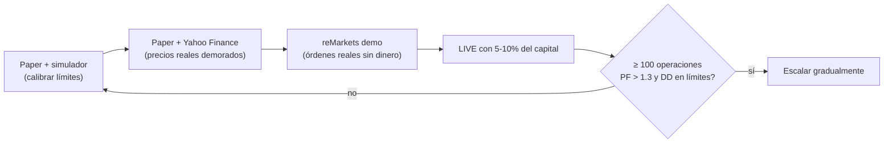

# Recomendaciones del IA Engineer

## 1. ¿Se puede operar sin pasar por un broker?

**En BYMA, no.** La Ley de Mercado de Capitales (Ley 26.831) y la normativa CNV exigen que toda orden sea
canalizada por un **ALyC** (Agente de Liquidación y Compensación) o un Agente de Negociación registrado.
Un particular no puede conectarse directamente al motor de BYMA.

Lo más cercano a un acceso directo es:

| Opción | Qué es | Ventaja | Requisito |
|--------|--------|---------|-----------|
| **Primary API (Matba Rofex)** | Acceso DMA (Direct Market Access) vía API REST + WebSocket | Latencia baja, estándar algorítmico, demo gratis (reMarkets) | Cuenta en un ALyC que la habilite |
| **API del ALyC** (IOL, PPI…) | API propia del broker | Simple de integrar | Cuenta en ese broker |
| **Ser ALyC** | Registrarse ante CNV | Acceso directo real | Patrimonio neto mínimo elevado, estructura de compliance: no viable para una persona |

👉 **Recomendación:** Primary API vía pyRofex. Empezá en **reMarkets** (demo) y luego conectá un ALyC con Primary API.

## 2. La verdad incómoda sobre el scalping de 1-5 minutos

- Con comisiones retail (~0.5% + IVA por lado + derechos de mercado) el costo ida+vuelta ronda **1.3%**.
  Un movimiento típico de 5 minutos en el panel líder es de **0.2%-0.5%**. **La operación nace perdiendo.**
- El Analista Jefe rechaza automáticamente toda señal cuyo objetivo no cubra 2× los costos. Si cargás las
  comisiones reales y el sistema "no opera", **está funcionando bien**: te está protegiendo.
- En nuestro simulador (6 h, 8 corridas), con costos bajos (0.34% ida+vuelta):
  - Ventana 5 min / 12 ops por hora → P&L promedio **-1.43%** (casi todos los días cortados por el límite de pérdida diaria; los costos ≈ 90% de la pérdida).
  - Ventana 20 min / 6 ops por hora → P&L promedio **-0.89%**, con días positivos.
  - El simulador NO predice el mercado real, pero muestra la dirección: **menos operaciones y horizontes más largos = menos costos.**

**Recomendaciones concretas:**
1. Negociar comisión intradiaria bonificada (muchos ALyCs bonifican la operatoria intradiaria/por API).
2. Extender `max_holding_minutes` a 15-60 min y bajar `max_trades_per_hour`.
3. Operar instrumentos más líquidos y con spreads chicos (AL30/GD30, GGAL, YPFD, PAMP) y evitar el panel general.
4. Considerar **futuros en MATba-ROFEX** (dólar, índice): costos mucho menores, apalancamiento controlado y sin restricción de short.

## 3. Hoja de ruta segura hacia dinero real

## 4. Mejoras sugeridas (roadmap)

| Prioridad | Mejora | Valor |
|-----------|--------|-------|
| Alta | Backtesting con datos históricos reales de 1 min (descarga desde Primary / proveedor de datos) | Validar ventaja antes de arriesgar |
| Alta | Stop-loss nativo en el broker (orden stop) además del stop del bot | Protección si el bot/Internet cae |
| Alta | Watchdog + alertas Telegram/WhatsApp (circuit breaker, desconexión, fills) | Supervisión humana remota |
| Media | Adaptador PPI y WebSocket de Primary (en lugar de polling) | Menor latencia |
| Media | Agente LLM de noticias/sentimiento (BCRA, INDEC, riesgo país, dólar CCL) que alimente al Jefe como "veto" adicional | Detectar eventos difíciles de diagnosticar |
| Media | Correlación entre posiciones (evitar 4 bancos a la vez) | Diversificación real |
| Media | Persistencia en SQLite/PostgreSQL + reportes diarios PDF | Auditoría e impuestos |
| Baja | Despliegue en VPS en Buenos Aires con systemd/Docker | Disponibilidad y menor latencia |

## 5. Seguridad operativa
- Usá una **cuenta comitente dedicada** con sólo el capital asignado al bot.
- Habilitá 2FA en el broker; las credenciales de API deben tener el mínimo permiso posible.
- Revisá el journal diario y conciliá con el resumen del broker.
- Impuestos: las ganancias por compraventa de acciones/bonos tienen tratamiento específico en Argentina; consultá con un contador.

> ⚠️ Este software es educativo y no constituye asesoramiento financiero. Ningún sistema garantiza ganancias.
